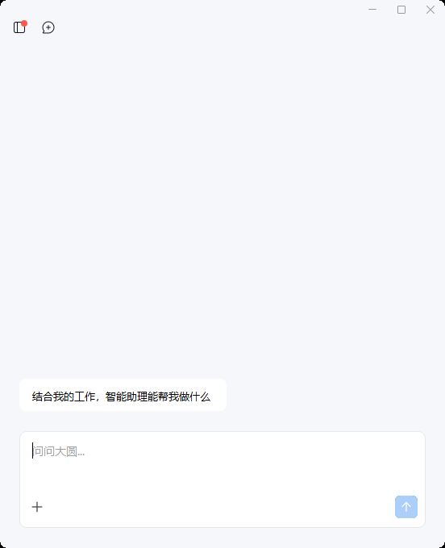
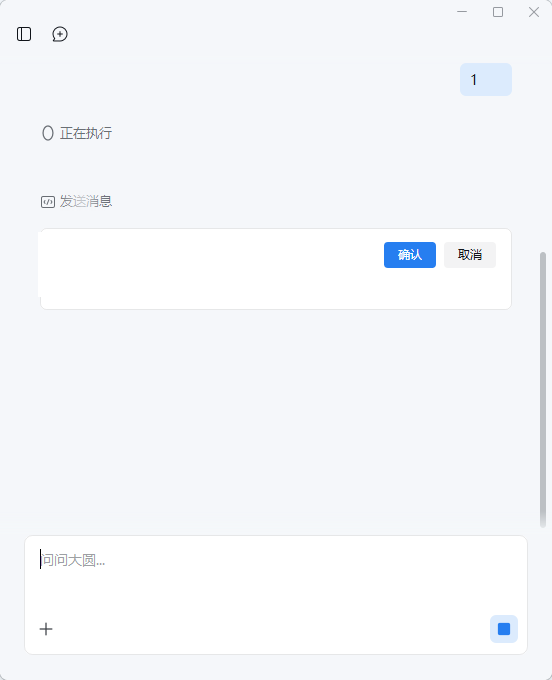

# DaYuan CLI


把企业微信里的「智能助理」（大圆）**当成一个命令行工具来用**。

大圆是纯云端的：推理、沙箱、提示词、工具全在腾讯云上，本机只有企微客户端在做加密转发。
本机**不存在任何"大圆 API"**（实测见文末），唯一能操作它的入口就是那个「智能助理」窗口。
所以这里做的事是：**把窗口自动化包装成 CLI** —— 能发、能等、能读、能自动点确认。

```powershell
dayuan ask "帮我看看有哪些未读消息"   # 发一句、等它跑完、把回复打出来
dayuan auto-reply                    # 常驻：定时查未读 + 自动回复
dayuan wake                          # 窗口关着也能叫出来
```

> **免责声明**：本项目通过桌面自动化驱动企业微信客户端，属于非官方用法。
> 请自行评估是否违反腾讯《企业微信服务协议》及所在企业的合规要求，风险自负。
> 作者不对任何账号处罚、消息误发或数据泄露负责。仅供研究与个人自动化学习使用。

> 目录名建议用 ASCII 路径是故意的：中文路径在命令行参数传递和 cmd/PS 的代码页上
> 已经坑过两次（`launch_app` 报"文件名、目录名或卷标语法不正确"、`.bat` 里的中文注释被执行）。

## 界面预览

| 待命状态 | 发送前确认（自动点「确认」） |
|---|---|
|  |  |

## 核心能力

- `ask`：发一句话给大圆，等它跑完，把回复读回终端
- `auto-reply`：常驻，定时查未读并自动回复，支持白名单 / 黑名单与只审不发
- `wake`：窗口关着也能把大圆叫出来
- `approve` / `watch`：自动识别并点击确认卡，点击后验证
- `doctor` / `check`：权限、窗口、抓图、地标体检与离线自检

## 快速开始

```powershell
git clone https://github.com/liao96312/dayuan-cli
cd dayuan-cli
pip install pillow          # 可选，仅自检读 PNG 时需要
python dayuan_watch.py doctor
python dayuan_watch.py ask "帮我看看有哪些未读消息"
```

运行环境：Windows + 已登录的企业微信桌面端，Python 3.10+，以普通权限运行（见下文）。

## 目录结构

```text
dayuan_watch.py        主程序（纯标准库）
dayuan.cmd             命令包装：dayuan <子命令>
start-*.cmd            双击启动 auto-reply / watch
auto-reply.txt         auto-reply 提示词（可改）
drive.txt              watch 默认注入的提示词
ocr_image.ps1          调用 Windows OCR 读图
samples/               打过码的自检截图
dev/                   测量与实验脚本
state/                 运行日志与截图（已 gitignore，不入库）
```

## 自检样本

仓库里的 `samples/` 放了两张**打过码**的窗口截图，clone 下来就能验证判定逻辑：

```powershell
python dayuan_watch.py check samples\ref_consent_redacted.png   # 应认出「确认」按钮
python dayuan_watch.py check samples\ref_idle.png               # 应报没有确认卡
```

打码只盖住了正文和联系人姓名，**按钮的像素几何原样保留**，所以自检结果与真实截图一致：

```
consent = {'x': 384, 'y': 242, 'w': 52, 'h': 26, 'area': 1164, 'cx': 410, 'cy': 255}
```

读 PNG 需要 Pillow（`pip install pillow`）；主程序本身是纯标准库，不装也能跑。

## 命令

```powershell
cd <你放本项目的目录>

python dayuan_watch.py auto-reply                   # 常驻：定时查未读 + 自动回复（默认 300 秒）
python dayuan_watch.py auto-reply --interval 120    # 每 2 分钟
python dayuan_watch.py auto-reply --once            # 只注入一轮，先看它想干什么
python dayuan_watch.py auto-reply --review          # 只审不发：读懂卡片后点「取消」
python dayuan_watch.py auto-reply --allow 张三 --deny 老板

python dayuan_watch.py ask "帮我看看有哪些未读消息"    # 发一句，等它跑完，打印回复
python dayuan_watch.py ask "..." --timeout 600 --out r.txt
python dayuan_watch.py read                        # 把当前对话读成文本（OCR）
python dayuan_watch.py status                      # 忙不忙 / 有没有待确认卡 / 地标（JSON）
python dayuan_watch.py wake                        # 把大圆窗口叫出来（窗口关着也能叫）
python dayuan_watch.py approve                     # 单次：有确认卡就点掉（带点击后验证）
python dayuan_watch.py watch                       # 常驻：定时注入 + 自动点确认（通用版）
python dayuan_watch.py doctor                      # 体检：权限 / 窗口 / 抓图 / 抢前台 / 地标
python dayuan_watch.py check state\ref_consent.bmp   # 对一张 BMP 跑判定（自检）
```

斜杠形式也认：`dayuan /auto-reply` 等价于 `dayuan auto-reply`。

也可以直接用包装脚本：`dayuan ask "..."`（见 `dayuan.cmd`）、双击 `start-auto-reply.cmd`（自动回复）。

`ask` 的退出码：`0` 拿到回复 / `2` 窗口问题 / `3` 超时且内容没变 / `4` 没读到回复。

日志：`state\watch.log`；每次点确认前的现场截图：`state\shots\approve-*.bmp`（保留最近 50 张）。

**`ask` / `read` / `watch` / `auto-reply` 都会自己唤醒大圆**，不需要你先把窗口点开。窗口关着、最小化都能处理。

## /auto-reply：定时让大圆查未读并回复

一条命令跑起来：

```powershell
dayuan auto-reply            # 每 5 分钟一轮，跑到 Ctrl+C
```

每一轮做四件事：

1. 到点把 `auto-reply.txt` 里的提示词注入大圆；
2. 大圆去查未读、判断该回谁、把回复拟好；
3. 大圆在真发之前弹出确认卡；
4. **CLI 先读懂卡片**（发给谁、发什么）→ 过名单策略 → 再决定批还是撤。

### 提示词的设计（`auto-reply.txt`，首次运行自动生成，随时可改）

定时注入最容易出的问题是**反复回同一批消息**和**见谁都回**，所以提示词重点压这两件事：

| 设计点 | 为什么 |
|--------|--------|
| 先判"要不要回"：通知 / 广告 / 系统消息 / 群里的刷屏闲聊一律跳过 | 不然每轮都会去回一堆根本不该回的东西 |
| **明确禁止重复回复**：已在这个对话回过、或最后一条本来就是它自己发的 → 跳过 | 每 5 分钟注入一次，不写死这条就会反复回同一批消息 |
| 回复要短（一两句）、口语化、"像我自己在打字" | 挡掉"作为AI助手，很高兴为您服务"这种一眼假的腔调 |
| 群聊只在明确 @ 到我时才回，且只回一句 | 防止在群里刷屏 |
| 拿不准要不要回的，就不要回 | 保守优先 |
| 结尾给一份三行简报：回了谁 / 回了什么 / 跳过了谁和为什么 | 日志里能直接看出它干了什么 |

### CLI 知道自己在批什么

早期版本是**盲点批准**：只要长成"蓝底白字主按钮 + 右侧浅灰取消键"就点，不区分内容。
现在多了一步——把卡片上的「发送消息给: X / 消息内容: Y」OCR 出来，日志里留下痕迹：

```
10-13 11:46:47 确认卡：发给「文件传输助手」内容「卡片读取测试」
10-13 11:46:47 --review：只审不发，点「取消」（无名单限制）
```

实测单倍数 OCR 不够：2x 认对内容但收件人会认错一个字，3x 认对名字但内容花掉，所以**两轮合起来用**。

### 名单是 fail-closed 的

名字来自 OCR，必然有误识，所以：

- 匹配用**滑动窗口 + 相似度 ≥ 0.6**——拿整个「研发部·张三」直接比「张三」只有 0.36，
  必须比子串；3 个字错 1 个是 0.667，能容忍单字误识；
- **设了 `--allow` 却读不出收件人时，一律拦下来**（点「取消」），而不是放行——
  否则 OCR 一失手，白名单就等于不存在。

`--review` 是个安全的总开关：读懂卡片、写进日志，但**永远点「取消」**，一轮下来只审不发。

## 主动唤醒（双击 Ctrl）

企微内置的全局热键：**连按两下 Ctrl** 就能把「智能助理」窗口叫出来（实测窗口完全关闭时也能叫出，约 0.6 秒）。

为什么不用点主窗口左栏那个「智能助理」入口：那个窗口整棵 UIA 树**只有 0 个元素**（和智能助理窗一样是自绘的），
拿不到元素就只能坐标点击，反而更脆。热键不依赖任何窗口位置。

`wake()` 的顺序是：

1. 窗口在且没最小化 → 直接用；
2. 窗口在但最小化 → `ShowWindow(SW_RESTORE)` 还原；
3. 窗口不存在 → 双击 Ctrl 叫出来，轮询等它出现（再按需还原）。

> 窗口句柄**每次重开都会变**（实测 `3279190` → `3737942` → `4196508`），所以代码里绝不缓存 hwnd，每轮按标题重找。

## 坐标不再是写死的（重要）

早期版本写死了一堆比例：输入框 `(0.45, 0.86)`、发送键 `(0.911, 0.924)`、消息区 `(0.5, 0.35)`、OCR 裁剪 `8%~78%`。
**窗口一挪一动、或者企微改了布局，就全废。**

现在改成**从图里认地标**：先在窗口底部认出"那块白色圆角容器"（装着"添加/当前屏幕"那一排 + 输入框），
输入框点击点、发送键、消息区、OCR 裁剪范围全部由它推导。

实测（窗口从 552x680 改到 760x900 / 440x640，再挪位置）：

| 场景 | 窗口 | 检测到的输入容器 | 发送键 | 旧比例法的偏差 |
|------|------|------------------|--------|----------------|
| 原始 | 552x680 | `(25,536)-(526,653)` | `(503,629)` | — |
| 只挪位置 | 552x680 | 不变 ✓ | 不变 ✓ | input 偏 48,16px |
| 放大 760x900 | 760x900 | `(25,756)-(734,873)` ✓ | `(711,849)` ✓ | input 偏 **69,46px** |
| 缩小 440x640 | 440x640 | `(25,496)-(414,613)` ✓ | `(391,589)` ✓ | input 偏 37,10px |

放大到 760x900 后跑完整 `ask`，照样 12.9 秒拿到回复。

`doctor` / `status` 会打出 `landmark_source`：`detected` 是从图里认出来的，`fallback` 表示没认出、退回旧比例（这时日志会警告）。

### 相对量（实测锚定）

| 常量 | 值 | 含义 |
|------|-----|------|
| `WHITE_MIN` | 248 | 输入框是纯白；消息区背景 `#F5F7FA`(≈246) 低于它 |
| `BOX_MIN_RUN` | 0.60 | 一行里白色连续段要占窗口宽度多少才算输入框行 |
| `SEND_INSET_X/Y` | 23 / 24 | 发送键中心相对容器**右下角**的内缩 |
| `INPUT_FX/FY` | 0.35 / 0.55 | 输入框点击点在容器内的相对位置（落在提示文字那行） |

## 它是怎么工作的

### 1. 「确认」按钮的识别

「智能助理」整窗是自绘的：UIA 只暴露 1 个元素（主窗口更是 0 个），Windows OCR 也读不出按钮上的白字（实测整行丢失）。
所以走像素判据，三条同时满足才认：

| 条件 | 值 |
|------|-----|
| 主按钮蓝实心连通块 | `#267EF0` ±32 |
| 面积 / 尺寸 | 450~6000 px、宽 28~96、高 18~42、填充率 ≥ 0.70 |
| 块内有白字 | 占比 0.8%~40% |
| 位置 | 输入容器之上（用 `scan_bottom`，不再是写死的 0.86H） |

**发送按钮为什么不会误判**：忙碌时它是「浅蓝底 `#DCE9FC` + 中心 13×13 小实心蓝」，那个小块面积只有 ~140（< 450），而且内部没有白字。宽度、面积、白字三项都过不了。

每条候选还会额外量一下右侧 96px 内浅灰（`#F2F3F5`，「取消」键底色）占比，正常在 0.7 左右——作为旁证记进日志。

### 2. 点击怎么投递（踩过大坑）

| 投递方式 | Low 完整性（沙箱/受限宿主内） | Medium 完整性（你自己跑） |
|----------|------------------------------|---------------------------|
| `PostMessage` | 5 种变体（客户区坐标、窗口坐标、带 `WM_MOUSEMOVE`、`SendMessage` 同步、加长按住 400ms）**全部点不动** | ✅ **有效**，实测点掉真实确认卡并完成发送 |
| 抢前台 + 真实鼠标事件（`SendInput`） | 抢不到前台，必然失败 | ✅ 可用（兜底） |

所以 `approve()` 的顺序是：**先试 `PostMessage`** —— 正常权限下这一次就成，而且**全程不抢你的焦点**；
不成才抢前台用真实鼠标事件，最后再复查卡片是否真的消失。三种结果都写日志。

### 3. 怎么读到回复（另一个坑）

剪贴板里其实有 **4 种格式**，但三种文本格式都被**从对话开头截断**：

| 格式 | 内容 |
|------|------|
| `CF_UNICODETEXT` | 只有 **128 字符**，从对话开头截 |
| `HTML Format` | ~121 字符，同样从头截 |
| `WeChat_RichEdit_Format` | 同样从头截 |
| `WeWork Message` | Boost 序列化的 **8000 字节固定缓冲**，从头截 |

对话一长，**最新那条回复必然落在截断之外**——所以 `Ctrl+A` 全选这条路读不到最新内容。

改用 **截图 + Windows OCR**（截图永远显示最新内容），并且：

- OCR 前把图**放大**：实测 1x 会把"联通测试"识成乱码，放大后一字不差；
- 放大交给 `ocr_image.ps1` 里的 .NET `HighQualityBicubic`（自己写的最近邻放大精度不够）；
- **多倍数重试**（3x → 2x → 4x）：OCR 对倍数敏感，实测 3x 整行漏掉、2x 一字不差，重试能救回来；
- 用 **difflib 模糊匹配**定位"我发的那句"当锚点（OCR 会把"一句话"识成"一匀话"，精确匹配无效）；
- 用 OCR 返回的 **y 坐标**判断"同一气泡的续行"（长句会被拆成多行，否则续行会混进回复里）。

`WeWork Message` 只留作兜底。

## 必须普通权限运行

企业微信跑在 **Medium** 完整性级别。受限 shell（沙箱 / 低完整性 / 某些自动化宿主）是 **Low**，而
**Low 进程永远无法把 Medium 窗口顶到前台** —— 打字进不去、确认也点不动，连 `ShowWindow(SW_RESTORE)`
都会被忽略。这是 Windows 的完整性隔离，绕不过。

- ✅ 自己的终端、双击 `dayuan.cmd`、登录计划任务 —— 都是 Medium，正常。
- ❌ 别在沙箱/受限宿主里跑。`python dayuan_watch.py doctor` 会直接报出来。

窗口最小化 / 被关掉 / 被拖到屏幕外，现在都能自动处理（见上面「主动唤醒」「坐标不再是写死的」）。
`ask` / `read` 需要真实前台输入，会短暂抢一下焦点；不想被打扰就用 `watch --no-inject`。

## 提示词

`watch` 模式读 `drive.txt`（改完不用重启，每轮重新读）。`ask` 模式直接命令行传入。

## 为什么不做"CLI 直连"（实测记录 2026-10-13）

| 入口 | 实测结果 |
|------|----------|
| `127.0.0.1:9883` LLM 网关 | **连接即 RST**（带/不带 `Bearer`、GET/POST 全一样；Medium 权限下同样） |
| `127.0.0.1:9882` MCP 网关 | 连接即 RST |
| `127.0.0.1:50018` 引擎回连通道 | RST |
| `127.0.0.1:50010` | RST |
| `WXWorkCommand.exe` | **不是 CLI**：字符串只有 `CommandLineToArgvW`/`OpenMutexW`/`RegisterWindowMessageW`/`SendMessageTimeoutW`/`ShellExecuteW` + 3 个 `wxwork://` 链接，是纯启动器 |
| `wecomagent` SDK `_rpc.py` | 只有 `wecom.exec`（subprocess 跑 argv）+ 本地 fs 读写 → 给**本地引擎模式**用的 |
| 云端 `agent.work.weixin.qq.com` | 400 `create job failed` / 403 |
| 客户端网络 | TLS + 包级加密；Frida hook `recv` 只拿到密文，replay → access violation |
| 本地引擎 | 需服务端 `LocalWecomAgentGray` 开启；当前关闭，`openclaw.json` 从未生成 |

RST 而不是 401，说明这些端口**在 TCP 层就校验来者**（只服务主进程自己拉起的引擎），不是鉴权值的问题，猜 key 打不通。

## 与旧脚本的关系

`driver.py` 是上一版：只做定时注入，靠相对坐标 + 发送键像素判断忙闲，**不点确认**，遇到确认卡必然空转。
`dayuan_watch.py` 覆盖了它并补上自动确认与读取。旧的先留着当后备。

## 已知边界

- 按**形状**而不是文字批准。任何长成"蓝底白字主按钮 + 右侧浅灰取消键"的卡片都会被点，
  不区分内容是发消息还是别的操作。
- OCR 对**拉丁字母**不稳（实测 `CLI` 会识成 `C凵`）。中文正文可靠，混排时要留意。
- 如果回复内容和我发出去的提示词高度重合，锚点定位可能把回复误当续行丢掉——换句提示词即可。
- 窗口拖得**极窄**时输入框那排控件会换行，白色容器检测可能失配；这时 `landmark_source` 会变成
  `fallback`，日志会警告，`doctor` 也能看出来。
- 双击 Ctrl 是企微的全局热键，理论上可能被别的软件抢占；`wake` 失败时会明确报错而不是静默。
- 唤醒会**把大圆窗口弹到你面前**（这是它的设计用途）。无人值守时如果不想被打扰，
  就别让它最小化/关闭，`watch` 只在窗口消失时才会去唤醒。

## 当前状态

可日常使用的个人自动化工具，依赖企业微信客户端界面，客户端改版后地标可能需要重新测量。非官方用法，风险自负。

## 许可

[MIT](LICENSE)
